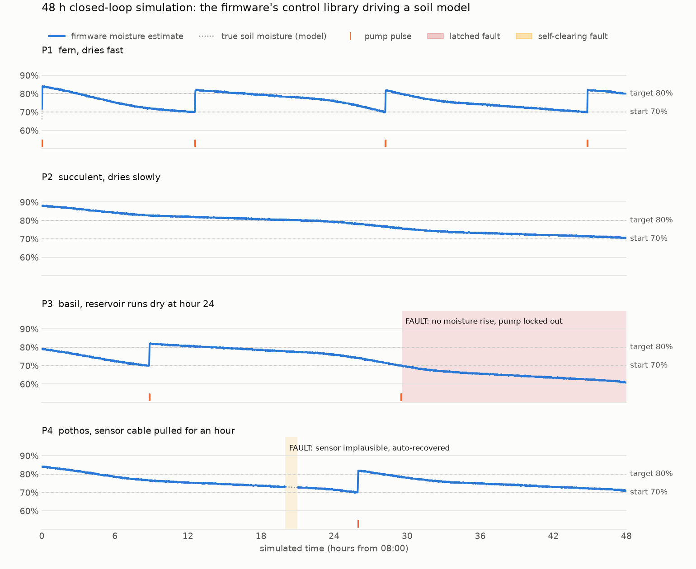
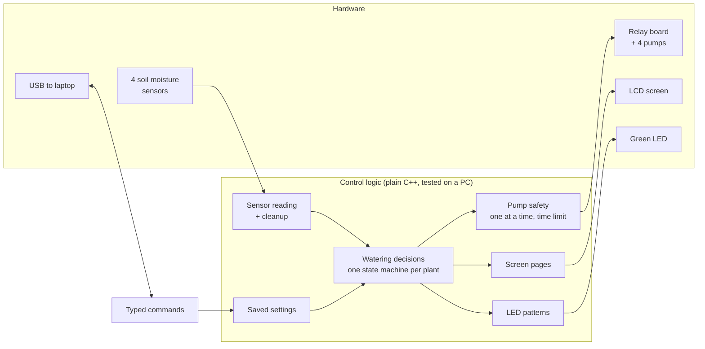
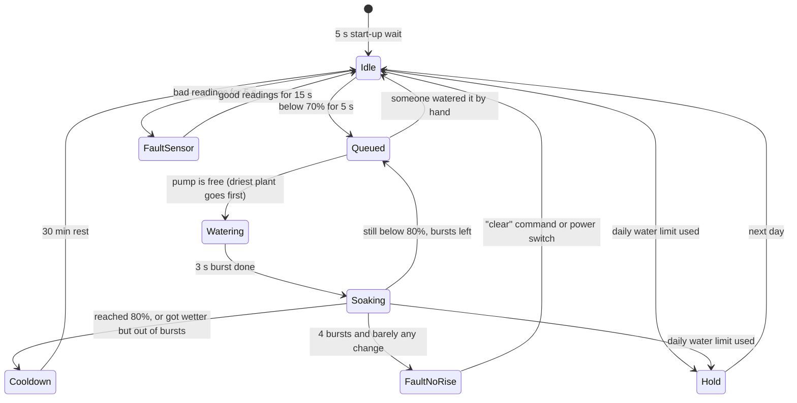

# Automated Irrigation System

[](https://github.com/kgandhi5/Automated-Irrigation-System/actions/workflows/ci.yml)


Two plant-care boxes that each look after **four plants** on their own. Every box has an Arduino
Uno, four soil moisture sensors, four water pumps switched by a relay board, a 16x2 LCD screen, a
green status LED and a power switch. The code checks how wet each pot is, waters the plants that
are too dry, and stops safely if something breaks: a sensor comes unplugged, a pump fails, or the
water tank runs empty.

<!-- Photos and demo video go here. Tip: drag an .mp4 into any GitHub comment box to get a link you can paste in. -->

## What it does

1. **Reads all four soil moisture sensors once a second.** Each reading is really 7 quick
   readings. The code keeps the middle one, which throws away random glitches.
2. **Shows each plant's moisture on the LCD**, for example `P1 59%  P2 97%  P3 73%  P4 62%`.
3. **Waters a plant once it has been below 70 % for 5 seconds.** It waters in short bursts: run
   the pump for 3 seconds, wait 60 seconds for the water to soak down to the sensor, then check
   again. It stops once the plant reaches 80 %, or after 4 bursts.
   - Starting at 70 % but stopping at 80 % leaves a gap between the two numbers. Without it,
     a plant sitting right at 70 % would make the pump flick on and off over and over.
4. **Runs only one pump at a time**, so the power supply is never overloaded.
5. **Uses the green LED to show status:** solid while a pump runs, with different blink
   patterns for "watering in progress", "something is wrong" and "all good".

## Features

- **Never freezes while waiting.** The code never uses `delay()`. It is split into small jobs
  (read sensors, decide, run pumps, update the screen, and so on) that take turns many times a
  second. This is called a cooperative scheduler.
- **Tracks each plant separately** with a state machine: each plant is always in exactly one
  step, such as resting, waiting for the pump, watering, soaking or faulted, and the code
  moves it between steps.
- **Cleans up sensor readings.** It keeps the middle of 7 readings, rejects readings that are too
  jumpy or out of range, and smooths the result. All of it uses whole-number math, which is
  much faster on the Arduino than decimals.
- **Has several independent safety features** (see [Safety features](#safety-features)):
  - detects a broken or unplugged sensor
  - detects an empty water tank
  - limits how much water each plant can get per day
  - limits how long a pump can stay on
- **Restarts itself if the code ever freezes**, using the chip's watchdog timer. After the
  restart it reports which job was running when the freeze happened.
- **Saves settings in EEPROM**, memory that keeps its contents with the power off. A checksum
  (CRC-16) catches settings that were corrupted.
- **Can be configured from a laptop** over USB with simple typed commands. You can change the
  thresholds, calibrate sensors, or water a plant by hand.
- **Updates the screen without flicker** by only redrawing the characters that changed.
- **Tested on a computer, not just on the board.** There are 53 automatic unit tests plus a
  48-hour simulation of four plants. GitHub runs all of them every time code is pushed.

## Simulation

The simulation is a **computer model** of four potted plants, not real plants. Water evaporates
faster during the day, takes about 20 seconds to soak down to the sensor, and the sensors have
realistic noise and random glitches. The real watering code is connected to this model and runs
for 48 simulated hours, which takes about one second on a laptop.

To prove the safety features work, two problems are caused on purpose. P1 and P2 are left alone,
to show that healthy plants are not affected.

- **P3's water tank runs empty at hour 24.** The code should notice that watering stopped
  making the soil wetter, and stop using that pump.
- **P4's sensor cable is unplugged for one hour.** The code should notice that the readings
  make no sense, stop watering P4 during that time, and recover by itself once the cable is back.

<picture>
  <source media="(prefers-color-scheme: dark)" srcset="docs/images/simulation-dark.png">
  
</picture>

At the end of each run, the simulation checks:

| Check | Result |
|---|---|
| Never more than one pump on at once | pass |
| The 15-second pump safety limit never had to step in | pass |
| No plant got more than its daily water limit | pass |
| Healthy plants (P1, P2, P4) never dropped below 60 % | pass |
| P3: empty tank detected, and its pump was not run again | pass |
| P4: unplugged sensor detected, and recovered on its own | pass |
| No false alarms on the healthy plants, even with random sensor glitches | pass |

## How the code is organized



The code is split into two parts:

- [`lib/irrigation_core`](lib/irrigation_core/src/irrigation) holds all of the decision-making.
  It doesn't use any Arduino functions, so it also runs on a normal computer. That is what makes
  the unit tests and the simulation possible.
- [`src/`](src) is the thin layer that talks to the actual hardware: pins, sensors, relays, the
  LCD, EEPROM and the watchdog.

The main loop runs these jobs, each on its own timer:

| Job | Runs every | What it does |
|---|---|---|
| `sensors` | 20 ms | Reads all four sensors once a second. Skipped while a pump runs, because the motor adds electrical noise. |
| `control` | 50 ms | Moves each plant through its watering steps, and picks which plant gets the pump next |
| `pumps` | 10 ms | Applies the 15-second pump limit and sets the relay pins |
| `led` | 25 ms | Blinks the status LED |
| `ui` | 250 ms | Redraws the LCD |
| `tlm` | 100 ms | Optional data logging over USB |
| `console` | every loop | Reads typed commands |

### Watering steps for each plant



| Step | Meaning |
|---|---|
| `Idle` | Soil is wet enough; just watching |
| `Queued` | Needs water, waiting its turn for the pump |
| `Watering` | Pump is on |
| `Soaking` | Pump is off, waiting for the water to reach the sensor |
| `Cooldown` | Finished watering; short rest before it can start again |
| `Hold` | Used up today's water limit |
| `FaultSensor` | Sensor readings make no sense (unplugged or broken wire); fixes itself when readings are good again |
| `FaultNoRise` | Watered 4 times but the soil didn't get wetter: tank is probably empty. Stays stopped until you refill the tank and flip the power switch. |

`FaultNoRise` stays stopped on purpose. If the tank is empty, trying again would just run the
pump dry, which can damage it.

### Safety features

| Safety feature | What it protects against |
|---|---|
| Relay pins set to OFF before anything else at start-up | a pump twitching on while the board boots |
| 5 s wait after power-on, and dryness must last 5 s | reacting to readings that haven't settled yet |
| Sensor sanity checks (in range, not jumpy), held for 5 s | an unplugged sensor reading "dry" forever and flooding the pot |
| Give up after 4 bursts if the soil didn't get at least 3 % wetter | empty tank, broken pump, kinked tube, sensor pulled out of the soil |
| Daily water limit per plant (60 s of pumping) | over-watering from any bug or a drifting sensor |
| One pump at a time, with a short gap between pumps | power-supply dips when a motor starts |
| Any pump is forced off after 15 s, separately from the watering logic | a bug leaving a pump on |
| Relay pins re-set every 10 ms | an electrical glitch flipping a pin |
| Watchdog timer (2 s) | the code freezing; the board restarts and reports where it froze |
| Checksum on saved settings | corrupted settings after a power cut |

## Hardware

Per box:

| Part | Notes |
|---|---|
| Arduino Uno (ATmega328P chip) | 32 KB of program space, 2 KB of RAM, 1 KB of EEPROM |
| 4 soil moisture sensors | capacitive or resistive; both work once calibrated |
| 4-channel 5 V relay module | switches the pumps on and off |
| 4 small 3-5 V submersible water pumps + tubing | one per plant |
| 16x2 character LCD | 2 rows of 16 characters |
| Green LED + 220 Ω resistor | status light |
| Power switch, DC power supply, breadboard, enclosure | |

### Pin map

These are set in [`include/board_config.h`](include/board_config.h). If your wiring is
different, change them there before uploading.

| Connected to | Arduino pin |
|---|---|
| Soil moisture sensors P1-P4 | A0, A1, A2, A3 |
| Relay inputs IN1-IN4 (pumps P1-P4) | 6, 7, 8, 9 |
| Green LED | 10 |
| LCD RS, E, D4, D5, D6, D7 | 12, 11, 5, 4, 3, 2 |
| LCD SDA / SCL (only for an I2C LCD) | A4 / A5 |

### LCD pages

The screen cycles through three pages on its own (there are no buttons): moisture for 7
seconds, plant status for 3 seconds, and system info for 2 seconds.

```
 P1  P2* P3  P4      1:OK    2:PUMP      Box 1   2d 03:15
 59% 97% 73% 62%     3:SOAK  4:FAIL      Today      450mL
```

The `*` next to a plant's name stands for a small icon: a water drop while pumping, or an
hourglass while waiting or soaking. `!` means a fault, and `#` means the daily water limit is used up.

### Status LED

| What you see | Meaning |
|---|---|
| Solid on | a pump is running |
| Short blink every second | a plant is in the middle of being watered |
| Double blink every 2 s | something is wrong; check the LCD status page |
| Quick flash every 4 s | all good, and the code is running |

## Build and upload

This project uses [PlatformIO](https://platformio.org/), either the VS Code extension or the
command-line tool.

```bash
pip install platformio
```

```bash
pio run -e uno -t upload
```

```bash
pio device monitor
```

For an LCD with an I2C adapter on the back (4 wires instead of 6+), use `-e uno_i2c_lcd`.

### Memory used on the Arduino

| Build | Program space | RAM |
|---|---|---|
| `uno` | 20,064 of 32,256 bytes (62 %) | 1,127 of 2,048 bytes (55 %) |
| `uno_i2c_lcd` | 21,622 of 32,256 bytes (67 %) | 1,340 of 2,048 bytes (65 %) |

## Typed commands (serial console)

Open the serial monitor at 115200 baud with "newline" line endings. Plants are numbered `1`-`4`,
and `*` means all four.

| Command | What it does |
|---|---|
| `status` | table of every plant: step, moisture, raw sensor value, water used today, faults |
| `config` | prints all settings |
| `set <plant> dry <percent>` | water below this moisture (default 70) |
| `set <plant> target <percent>` | stop watering at this moisture (default 80) |
| `set <plant> pulse <ms>` | how long each pump burst lasts (default 3000) |
| `set <plant> enable <0 or 1>` | turn a plant's watering off or on |
| `set soak <s>` / `cooldown <min>` / `pulses <n>` / `budget <s>` / `rise <percent>` | timing and safety limits |
| `set flow <ml/min>` / `id <n>` / `tlm <ms>` | pump flow estimate, box number, data logging |
| `cal <plant> dry` / `cal <plant> wet` | calibrate a sensor (see below) |
| `water <plant> <ms>` | water a plant by hand (all safety limits still apply) |
| `stop` | emergency stop: all pumps off |
| `clear` | clear faults after fixing the problem |
| `save` / `load` / `defaults` | save settings, reload them, or reset to defaults |
| `stats` | uptime, why it last restarted, free memory, timing of each job |
| `reboot` | restart the board |

The console also prints a line whenever something happens, such as
`[   3605.250] P2 pump on for 3000 ms`.

### Calibrating a sensor

Every sensor reads a little differently, so tell the code what "dry" and "wet" look like for each one:

1. Hold the sensor in dry soil or air for a few seconds, then type `cal 1 dry`.
2. Put it in a glass of water, then type `cal 1 wet`.
3. Do the same for sensors 2-4, then type `save`.

## Testing

```bash
pio test -e native
```

This runs 53 automatic tests on your computer in about 10 seconds; no Arduino needed. They
check things like "a dry plant gets watered", "an empty tank is detected", "only one pump runs at a
time", "a glitchy reading is ignored" and "the screen shows exactly the right characters".

To run the 48-hour simulation and redraw the graph:

```bash
g++ -std=c++11 -O2 -Ilib/irrigation_core/src sim/plant_sim.cpp lib/irrigation_core/src/irrigation/*.cpp -o plant_sim
```

```bash
./plant_sim --hours 48 --csv sim.csv --events events.csv
```

```bash
python tools/plot_simulation.py sim.csv events.csv docs/images
```

## Files

```
include/board_config.h          which pin is connected to what
src/                            hardware layer: main loop, pins, LCD, EEPROM, typed commands
lib/irrigation_core/src/irrigation/
  controller.*                  watering steps for each plant + choosing who gets the pump
  sensor_channel.*              cleaning up and converting sensor readings
  pump_bank.*                   pump safety: one at a time, 15 s limit
  scheduler.*                   runs each job on its timer
  settings.*, crc16.*           default settings, limits, saving with a checksum
  ui.*, lcd.*, led.*            screen pages, flicker-free drawing, LED blink patterns
  cli_parse.*                   reading typed commands
test/                           automatic tests (pio test -e native)
sim/plant_sim.cpp               48-hour plant simulation
tools/plot_simulation.py        draws the simulation graph
docs/images/                    simulation graphs
```

## Future work

- Water-level switch in the tank, to know it's empty before trying to water
- Real-time clock, to avoid watering in the midday heat
- Flow sensor, to measure water used instead of estimating it from pump time
- Wi-Fi version (ESP32) that sends both boxes' data to one online dashboard
